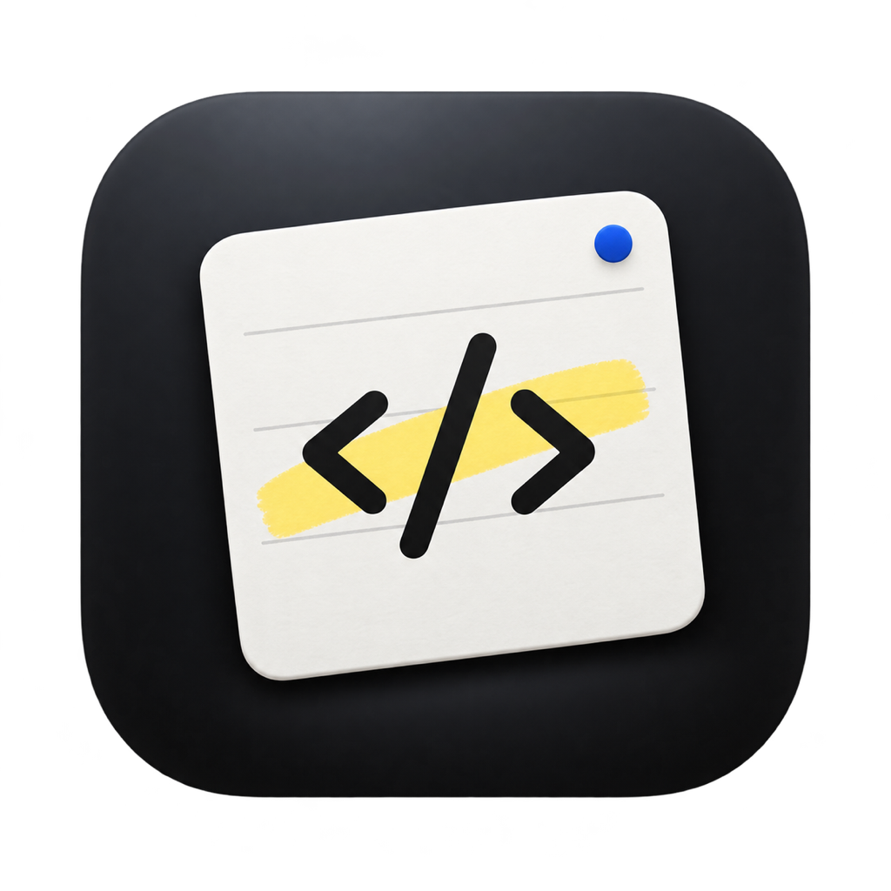
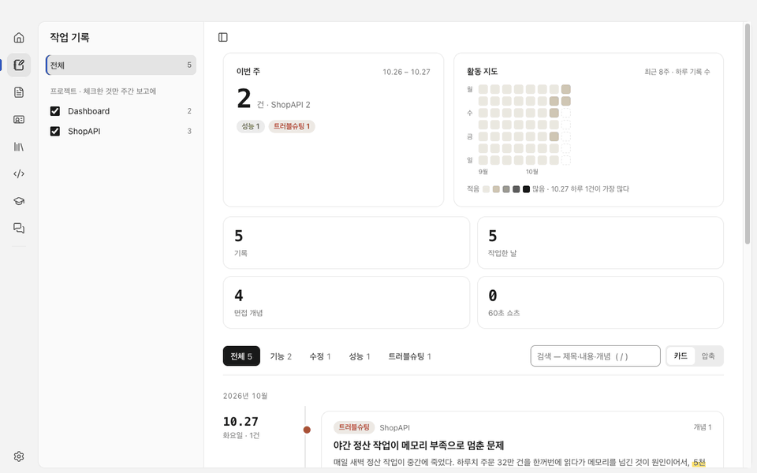
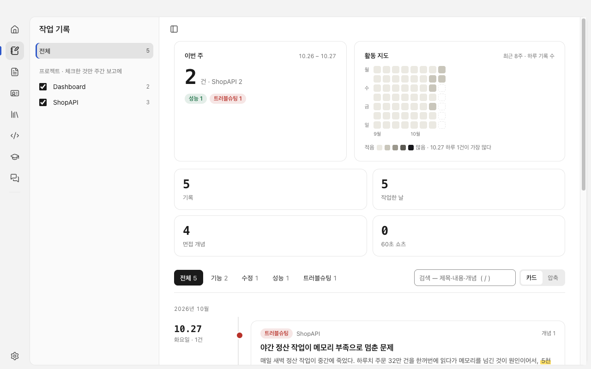
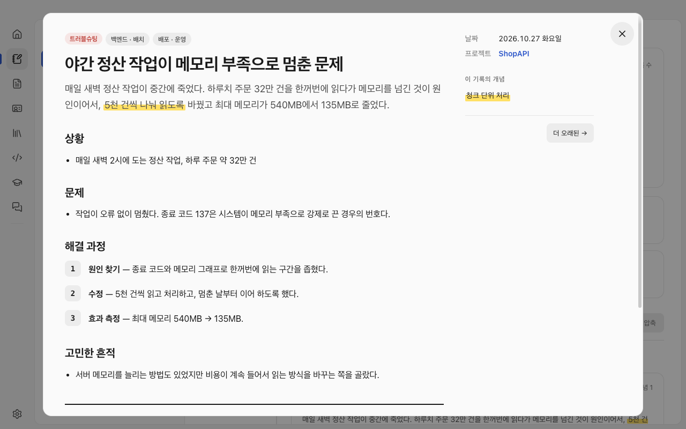
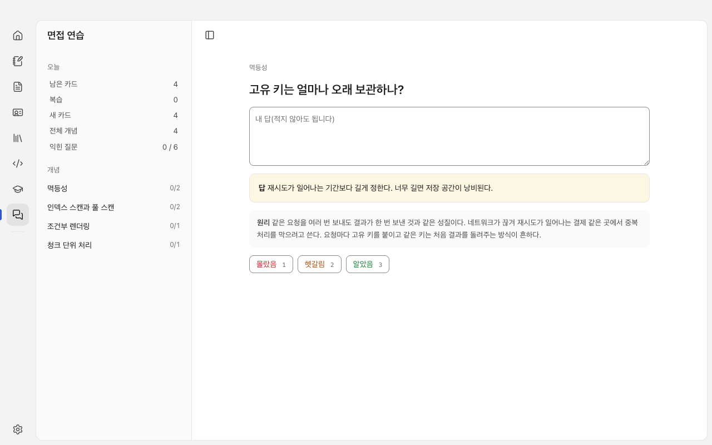
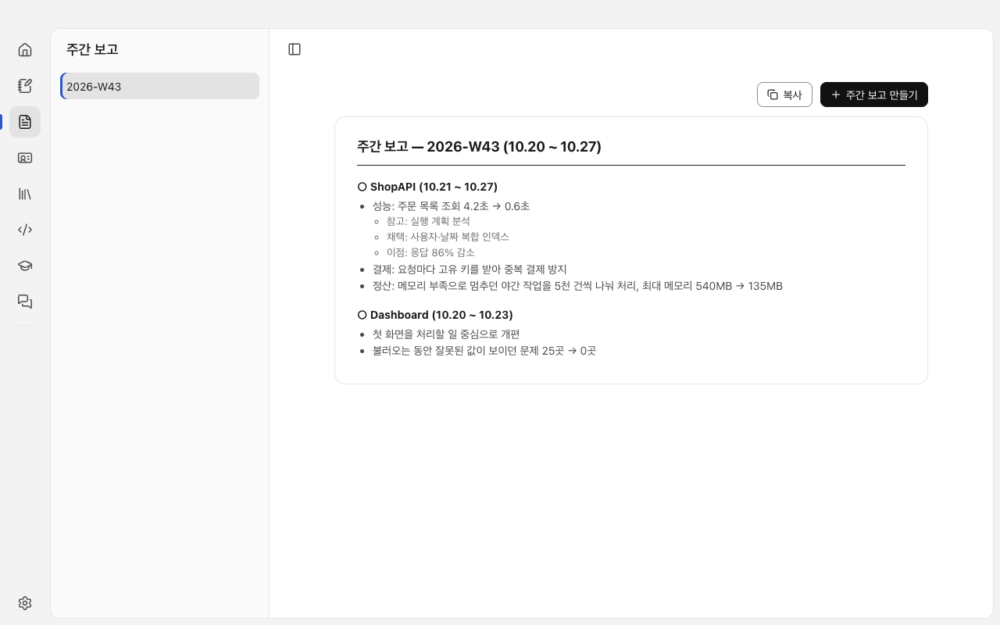
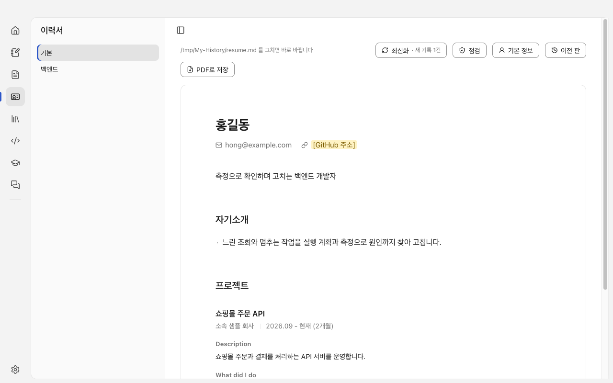

<div align="center">



# Inkline

**AI로 내 작업을 손쉽게 관리하고 내 커리어까지 관리하는 프로그램**

[](https://github.com/Jeonghoon2/inkline/releases/latest)


[](LICENSE)

[English](README.md) | **한국어**

</div>

## 왜 만들었나

하루하루 한 일은 금방 잊히고 주간 보고나 이력서를 쓸 때가 되면 기억을 다시 더듬어야 합니다. Inkline은 작업을 남기는 일부터 그 기록을 커리어로 바꾸는 일까지 한곳에서 AI와 함께 처리합니다.

| | 하는 일 |
| --- | --- |
| 📝 **작업 관리** | AI 도구가 남긴 작업 기록을 타임라인으로 모아 보고 기간을 고르면 주간 보고가 나옵니다 |
| 🚀 **커리어 관리** | 기록에서 이력서에 올릴 성과를 골라 고쳐 쓰고 기록 속 개념으로 면접 · 코딩 테스트를 연습합니다 |
| 🤖 **AI와 함께** | 이미 쓰는 `claude` · `codex` · `gemini` 명령줄 도구를 그대로 불러 씁니다 |

Electron, React, TypeScript로 만들었고 macOS와 Windows에서 돌아갑니다. 앱이 API 키를 따로 받거나 저장하지 않습니다.

> 화면 언어는 운영체제 언어(한국어 또는 영어)를 따르고, 환경설정에서 바꿀 수 있습니다. 영어로 두면 AI 결과도 영어로 나옵니다.



샘플 프로젝트(ShopAPI, Dashboard)의 가짜 기록으로 찍은 화면입니다. [mp4로 보기](docs/media/demo.ko.mp4)

## 설치

[Releases](https://github.com/Jeonghoon2/inkline/releases/latest)에서 운영체제에 맞는 파일을 내려받습니다.

| 파일 | 운영체제 |
| --- | --- |
| `Inkline-0.1.0-arm64.dmg` | macOS (Apple Silicon) |
| `Inkline-Setup-0.1.0.exe` | Windows (x64) |

- 서명하지 않은 빌드라 처음 열 때 경고가 나옵니다. macOS는 앱을 오른쪽 클릭해 [열기]를 고르고 그래도 막히면 시스템 설정 → 개인정보 보호 및 보안에서 [그래도 열기]를 누릅니다. Windows는 SmartScreen이 뜨면 [추가 정보] → [실행]을 누릅니다.
- 처음 켜면 작업 기록에 쓰는 Claude Code 스킬(`work-history`, `knowledge`, `concept-shorts`)과 전역 지침 두 줄을 설치할지 묻습니다. 고른 것만 설치합니다.
- AI 기능을 쓰려면 `claude`, `codex`, `gemini` 중 하나를 설치하고 로그인해 둡니다([AI 도구 연결](#ai-도구-연결)).

## 대표 기능

### 작업 기록: 쓴 기록이 타임라인이 됩니다



- 날짜별 카드로 기록을 모아 보고, 종류(기능, 수정, 성능, 트러블슈팅)와 프로젝트로 거르고 검색합니다.
- 최근 8주 활동 지도와 이번 주 요약이 위에 나옵니다.
- 기록 파일은 `~/My-History`의 마크다운이라 앱 없이도 읽고 고칠 수 있습니다.

### 면접 꼬리 질문: 기록에서 개념을 뽑아 복습합니다



- 기록 안에서 형광펜으로 칠한 개념(`==글자|개념 이름==`)이 개념 사전에 모입니다. 상세 창 맨 아래에 그 개념의 원리와 꼬리 질문이 붙고, 질문을 누르면 답이 펼쳐집니다.
- 상세 창은 상황, 문제, 해결 과정, 고민한 흔적, 성능 비교 순으로 읽힙니다.
- 개념마다 [60초 쇼츠 만들기]를 누르면 AI가 대본을 쓰고 음성과 세로 영상까지 만듭니다. 처음 한 번은 터미널에서 `sh ~/.claude/skills/concept-shorts/engine/setup.sh`(Windows는 `node %USERPROFILE%\.claude\skills\concept-shorts\engine\setup.mjs`)로 영상 부품을 설치해야 합니다.



- 면접 연습 탭은 개념의 질문을 카드로 보여 줍니다. 내 답을 적고 [답 보기]를 누른 뒤 몰랐음, 헷갈림, 알았음으로 스스로 매깁니다.
- 왼쪽에 오늘 남은 카드, 복습, 새 카드, 개념별 익힌 질문 수가 나옵니다.

### 주간 보고: 기록에서 만들고 복사합니다



- 기간의 기록을 프로젝트별로 묶어 보고를 만듭니다. 개발자용과 비개발자용 두 가지 말투를 고를 수 있습니다.
- 바꾼 것은 `기존 방식 → 바꾼 방식`으로 쓰고, 근거가 기록에 있으면 참고, 채택, 이유, 이점 줄을 붙입니다.

### 이력서: 기록에서 최신화하고 점검합니다



- [최신화]는 새 기록을 읽어 이력서에 넣을 것을 제안하고 [점검]은 지금 이력서에서 고칠 줄을 찾아 다시 쓴 안을 냅니다. 모두 카드로 보여 주고 저장은 직접 누를 때만 일어납니다.
- 직무별 이력서를 따로 두고 [이전 판]으로 되돌리고 PDF로 저장합니다.
- 아래 흐름으로 AI가 쓴 말투를 걸러 냅니다.

1. **판정(AI):** 새 기록이 이력서에 들어갈 만한지 가립니다.
2. **작성(AI):** 가이드에 맞춰 줄을 씁니다.
3. **윤문(AI):** 번역투와 빈 꾸밈말을 고칩니다. 숫자, 기술 이름, 줄 꼴이 하나라도 바뀌면 규칙이 거절하고 원래 글을 씁니다.
4. **검증(규칙):** 숫자와 근거가 기록에 있는지 대조합니다.
5. **확인(AI):** 사람이 보기 전에 한 번 더 걸러 냅니다.

### 그 밖의 탭

| 탭 | 하는 일 |
| --- | --- |
| 홈 | 오늘 할 일을 보여 주는 첫 화면 |
| 지식사전 | 판단 근거로 쓴 논문, 지침, 사례를 분류해 저장 |
| 코테 연습 | 프로그래머스, LeetCode 문제를 가져와 Python, Java, JavaScript, C++로 로컬에서 실행, 힌트는 단계별로 열림 |
| 자격증 | 교재 PDF를 가져와 문제로 공부 |

## 소스에서 빌드하기

Node.js 24 이상이 필요합니다. 내장 SQLite(`node:sqlite`)와 TypeScript 직접 실행을 씁니다.

```bash
npm install
npm run dev        # 개발 모드로 앱 열기
npm run typecheck  # 타입 검사
npm test           # 자동 시험
```

설치 파일도 직접 만들 수 있습니다.

```bash
npm run dist       # macOS(Apple Silicon) dmg, dist/ 에 생성
npm run dist:win   # Windows(x64) 설치 파일, macOS 에서 교차 빌드
```

앱이 함께 쓰는 Claude Code 스킬(`work-history`, `knowledge`, `concept-shorts`)은 [`skills/`](skills)에 있습니다. 두 설치 파일 모두 이 폴더를 넣어 가고, 앱을 처음 켜면 설치할지 묻습니다.

## AI 도구 연결

환경설정에서 쓸 도구와 모델을 고릅니다. 아래 중 하나 이상이 설치되어 로그인된 상태여야 AI 기능이 동작합니다.

- [Claude Code](https://claude.com/claude-code): `claude`
- Codex CLI: `codex`
- Gemini CLI: `gemini`

AI 없이 기록 보기, 코테 실행, 자격증 문제 풀이처럼 AI를 부르지 않는 화면은 그대로 쓸 수 있습니다. 이력서 최신화는 단계마다 AI를 한 번씩 부르므로 몇 분 걸릴 수 있고 도구에 따라 속도와 실패율이 크게 다릅니다.

## 데이터 위치

- 기록, 주간 보고, 이력서, 지식사전은 `~/My-History` 폴더의 마크다운 파일입니다. 앱은 이 파일을 읽고 저장할 때만 씁니다. 쓸 때는 임시 파일에 먼저 쓴 뒤 이름을 바꿔 중간에 깨진 파일이 남지 않게 합니다.
- 연습 기록과 설정은 앱 데이터 폴더의 SQLite 파일에 저장합니다. 이 폴더는 실행할 때 `--user-data-dir=<폴더>`로 바꿀 수 있어서 내 데이터를 건드리지 않고 시험해 볼 수 있습니다.
- 모든 데이터는 이 PC에만 있습니다. AI 도구를 부를 때 프롬프트에 든 내용은 그 도구의 제공자에게 갑니다.

## 구조

```
src/main/       앱 본체: 파일 읽기와 쓰기, AI 호출, 이력서 파이프라인, 코드 실행
src/main/ipc/   화면과 주고받는 메시지(채널 94개)를 영역별로 나눠 등록
src/renderer/   화면(React)
src/shared/     본체와 화면이 함께 쓰는 타입과 순수 함수
tests/          자동 시험(node --test), tests/fixtures/ 에 가짜 AI 응답
scripts/        AI 평가 도구와 공개용 스킬 생성기
docs/media/     이 README의 화면과 시연 영상
```

AI 응답 대신 시험용 응답을 쓰려면 `INKLINE_FAKE_AI=1`로 실행합니다. 이때 `tests/fixtures/ai/<작업>.json`을 읽으므로 저장소 폴더에서 실행해야 합니다.

## 현재 상태

개인 프로젝트이고 아직 0.1.0입니다. 사용 중 고친 것을 계속 쌓는 중이라 기능이 바뀌거나 빠질 수 있습니다. Windows 설치 파일은 만들어 시험했지만 실제 Windows PC에서 오래 써 보지는 못했습니다. 이슈와 제안은 환영합니다.

## 후원

<a href="https://www.buymeacoffee.com/jeonghoon"></a>

## 라이선스

[MIT](LICENSE)

이론 연습 장면은 [Remotion](https://www.remotion.dev)을 씁니다. Remotion은 라이선스가 따로 있어서 개인과 작은 회사는 무료이고, 그보다 큰 회사는 유료 라이선스가 필요합니다. 자세한 조건은 [remotion.dev/license](https://www.remotion.dev/license)에 있습니다.
