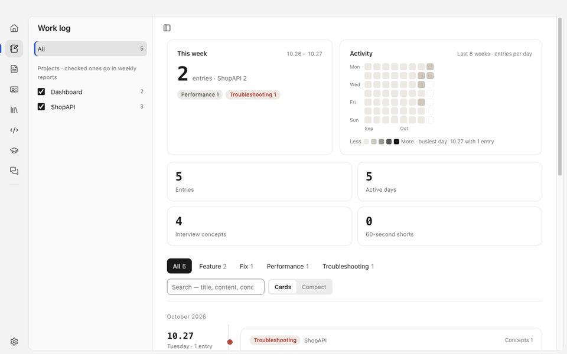
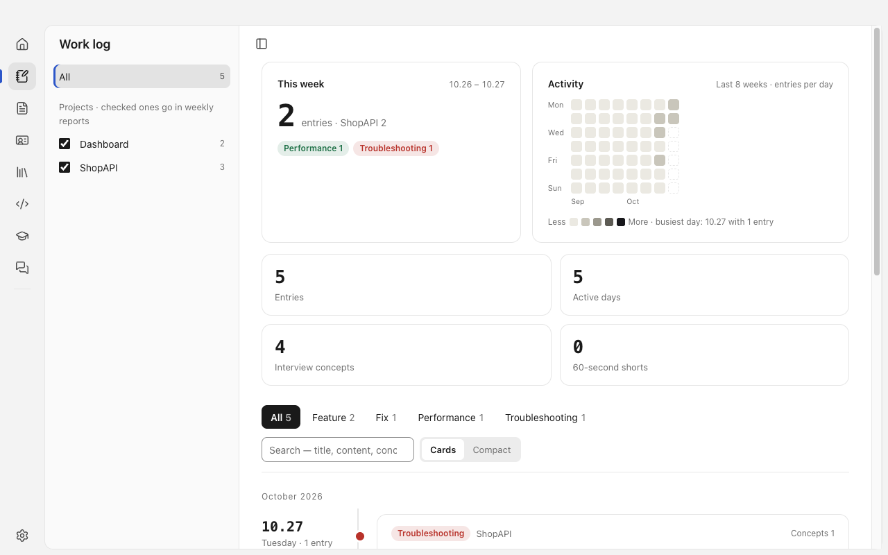
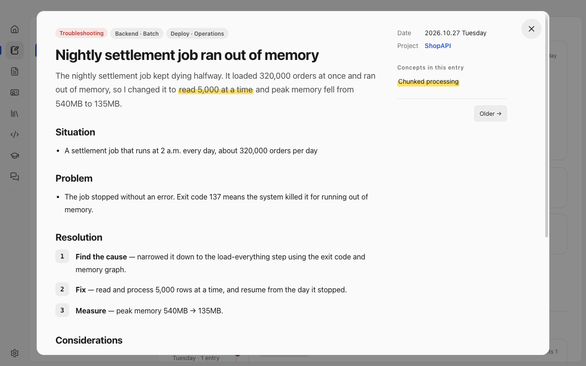
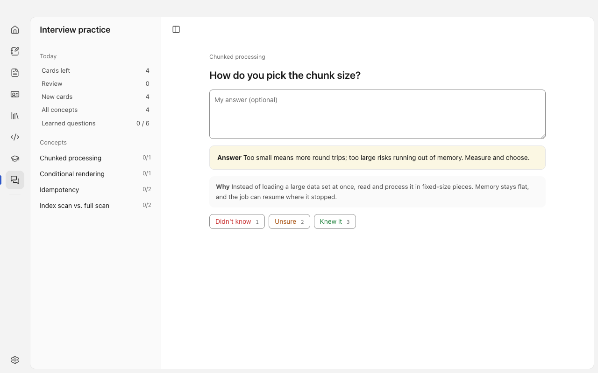
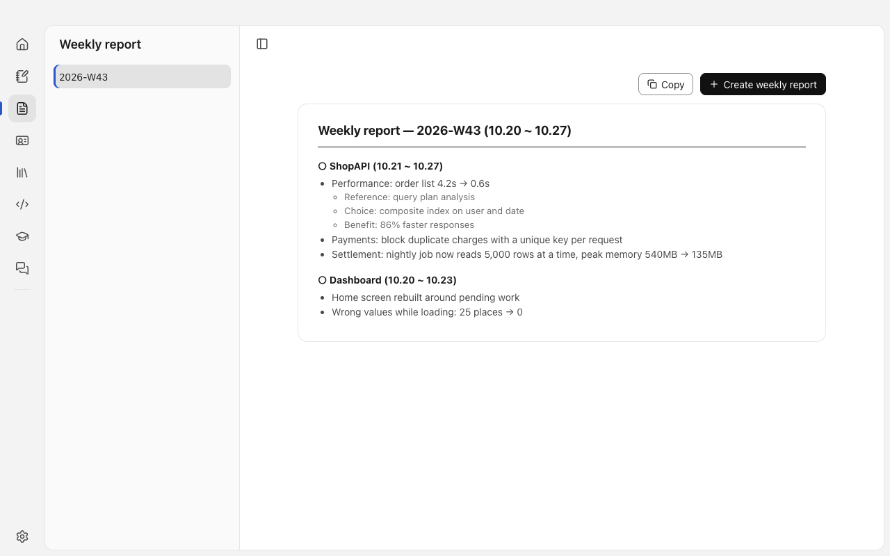
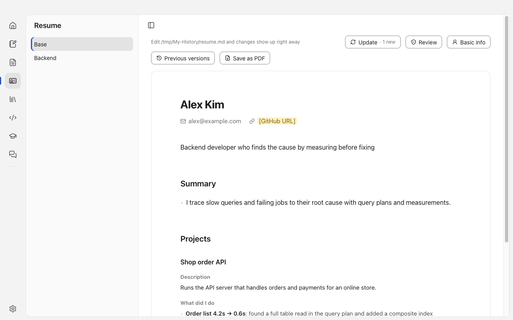

<div align="center">


# Inkline

**Manage your work with AI, and grow your career from it**

[](https://github.com/Jeonghoon2/inkline/releases/latest)


[](LICENSE)

**English** | [한국어](README.ko.md)

</div>

## Why Inkline

What you did each day fades fast, and when it's time to write a weekly report or update your resume you end up digging through memory. Inkline handles the whole path with AI, from logging your work to turning that log into your career.

| | What it does |
| --- | --- |
| 📝 **Manage your work** | Collect the work log your AI tools write into a timeline, and get a weekly report for any date range |
| 🚀 **Manage your career** | Pick resume-worthy results from the log and rewrite them, and practice interviews and coding tests on concepts from your own work |
| 🤖 **With the AI you already use** | Calls the `claude`, `codex`, or `gemini` command-line tool you already have |

Built with Electron, React, and TypeScript for macOS and Windows. The app never asks for or stores an API key.

> The interface follows your system language (Korean or English) and can be changed in Settings. In English mode, AI results are written in English too. Work-log files keep their Korean field labels (`- 종류:`, `#### 수행 일지`), which the app shows translated.



Recorded with fake records from sample projects (ShopAPI, Dashboard). [Watch as mp4](docs/media/demo.mp4)

## Install

Download the file for your system from [Releases](https://github.com/Jeonghoon2/inkline/releases/latest).

| File | Platform |
| --- | --- |
| `Inkline-0.1.0-arm64.dmg` | macOS (Apple Silicon) |
| `Inkline-Setup-0.1.0.exe` | Windows (x64) |

- The builds are unsigned, so you'll see a warning the first time. On macOS, right-click the app and choose Open; if it's still blocked, click Open Anyway in System Settings → Privacy & Security. On Windows, choose More info → Run anyway if SmartScreen appears.
- On first launch, Inkline asks whether to install its Claude Code skills (`work-history`, `knowledge`, `concept-shorts`) and add two lines to your global AI instructions. Only what you pick is installed.
- For AI features, install and sign in to one of `claude`, `codex`, or `gemini` (see [Connecting an AI tool](#connecting-an-ai-tool)).

## Key features

### Work log: your notes become a timeline



- Entries are grouped into cards by date. Filter by type (feature, fix, performance, troubleshooting) and project, or search.
- A heat map of the last 8 weeks and this week's summary sit at the top.
- Log files are Markdown in `~/My-History`, so you can read and edit them without the app.

### Interview follow-ups: concepts from your log, ready to review



- Concepts you highlight inside an entry (`==text|concept name==`) are collected into a concept dictionary. At the bottom of the detail view, each concept shows its explanation and follow-up questions, and clicking a question opens the answer.
- The detail view reads in this order: situation, problem, how it was solved, what you weighed, performance comparison.
- Press [Make 60-second short] next to a concept, and AI writes a script and turns it into a narrated vertical video. Run `sh ~/.claude/skills/concept-shorts/engine/setup.sh` once first (on Windows, `node %USERPROFILE%\.claude\skills\concept-shorts\engine\setup.mjs`) to install the video tools. Narration is Korean.



- The interview practice tab shows a concept's questions as cards. Write your answer, press [Show answer], then rate yourself as didn't know, unsure, or knew it.
- The left side shows today's remaining cards, reviews, new cards, and how many questions you've mastered per concept.

### Weekly report: generated from the log, ready to copy



- Entries for a period are grouped by project into a report. You can choose a developer or a non-developer tone.
- Changes are written as `old way → new way`. When the log has evidence, reference, choice, reason, and benefit lines are added.

### Resume: update and review from your log



- [Update] reads new entries and proposes what to add to the resume. [Review] finds lines worth fixing and proposes rewrites. Everything appears as cards, and nothing is saved until you press save.
- Keep a separate resume per job role, go back with [Previous versions], and save as PDF.
- The pipeline below filters out AI-sounding prose.

1. **Judge (AI):** decides whether a new entry belongs on the resume.
2. **Write (AI):** writes lines following the guide.
3. **Polish (AI):** fixes translationese and empty filler words. If any number, tech name, or line shape changes, a rule rejects the result and keeps the original text.
4. **Verify (rules):** checks that numbers and evidence exist in the log.
5. **Screen (AI):** one more pass before a human sees it.

### Other tabs

| Tab | What it does |
| --- | --- |
| Home | A start screen that shows what to do today |
| Knowledge | Save and categorize papers, guidelines, and cases you relied on for decisions |
| Coding practice | Import Programmers and LeetCode problems and run them locally in Python, Java, JavaScript, or C++, with hints that unlock step by step |
| Certifications | Import a textbook PDF and study with questions |

## Build from source

Node.js 24 or later is required. The app uses built-in SQLite (`node:sqlite`) and runs TypeScript directly.

```bash
npm install
npm run dev        # open the app in dev mode
npm run typecheck  # type check
npm test           # automated tests
```

You can also build the installers yourself.

```bash
npm run dist       # macOS (Apple Silicon) dmg, written to dist/
npm run dist:win   # Windows (x64) installer, cross-built from macOS
```

The Claude Code skills the app works with (`work-history`, `knowledge`, `concept-shorts`) live in [`skills/`](skills). Both installers bundle them, and the app asks whether to install them on first launch. The work-log format and the skill instructions are written in Korean.

## Connecting an AI tool

Pick the tool and model in Settings. At least one of these must be installed and signed in for AI features to work.

- [Claude Code](https://claude.com/claude-code): `claude`
- Codex CLI: `codex`
- Gemini CLI: `gemini`

Screens that don't call AI, such as viewing the log, running code in coding practice, and solving certification questions, work without it. Updating a resume calls AI once per stage, so it can take a few minutes, and speed and failure rate differ a lot between tools.

## Where your data lives

- Log entries, weekly reports, resumes, and the knowledge dictionary are Markdown files in `~/My-History`. The app reads them and writes only when you save. It writes to a temporary file first and then renames it, so a broken half-written file is never left behind.
- Practice records and settings are stored in a SQLite file in the app data folder. You can change that folder at launch with `--user-data-dir=<folder>`, which lets you try the app without touching your own data.
- All data stays on your machine. When an AI tool is called, the prompt contents go to that tool's provider.

## Project layout

```
src/main/       app core: file I/O, AI calls, resume pipeline, code execution
src/main/ipc/   the 94 messages exchanged with the UI, registered per area
src/renderer/   UI (React)
src/shared/     types and pure functions shared by core and UI
tests/          automated tests (node --test), fake AI replies in tests/fixtures/
scripts/        AI evaluation tools and the public-skills generator
docs/media/     screenshots and demo videos for this README
```

To use test replies instead of real AI output, run with `INKLINE_FAKE_AI=1`. It reads `tests/fixtures/ai/<task>.json`, so run it from the repository folder.

## Status

This is a personal project at version 0.1.0. Fixes made during daily use keep piling up, so features may change or go away. The Windows installer was built and tested, but I haven't used it on a real Windows PC for long. Issues and suggestions are welcome.

## Support

<a href="https://www.buymeacoffee.com/jeonghoon"></a>

## License

[MIT](LICENSE)

The theory-practice scenes use [Remotion](https://www.remotion.dev), which has its own license: free for individuals and small companies, a paid license for larger companies. See [remotion.dev/license](https://www.remotion.dev/license).
